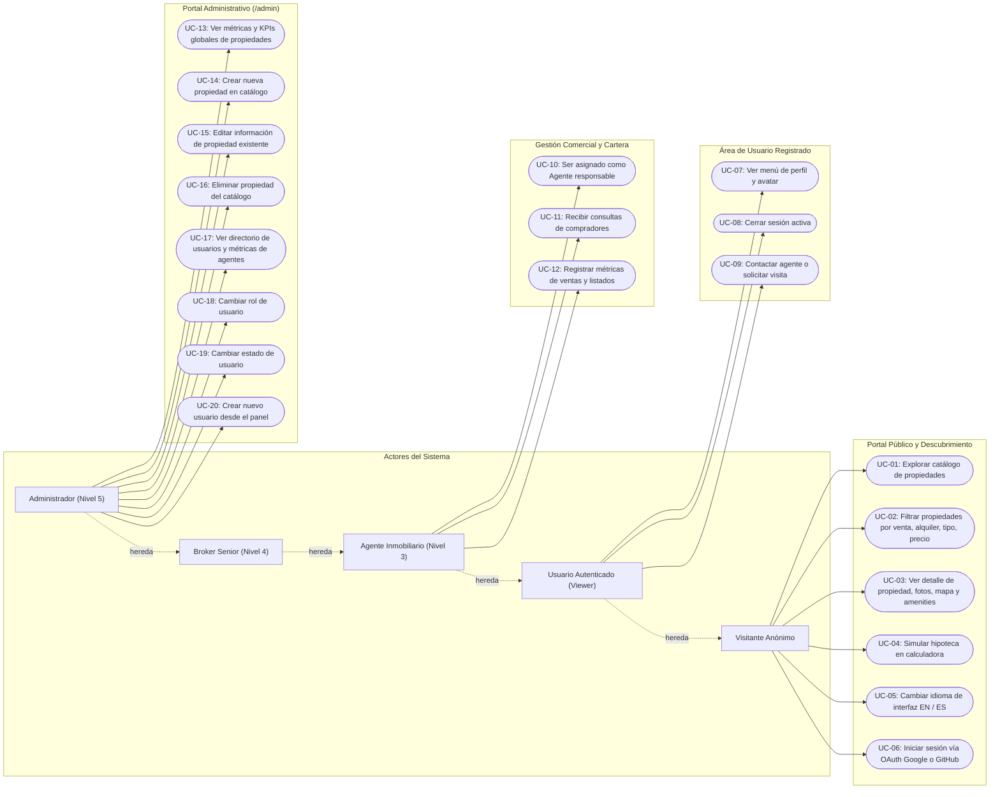
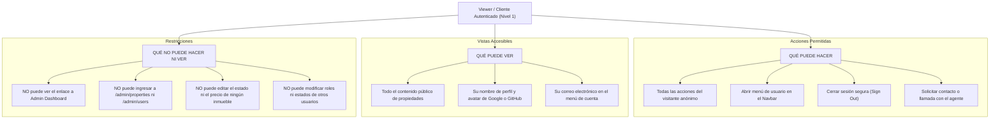
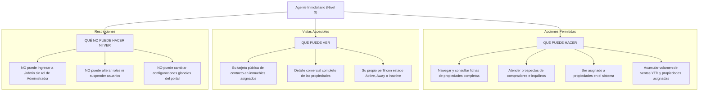
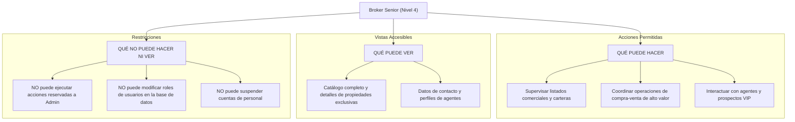
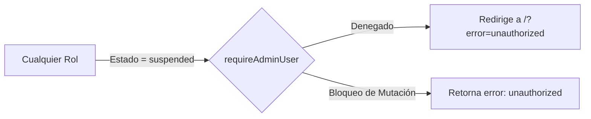
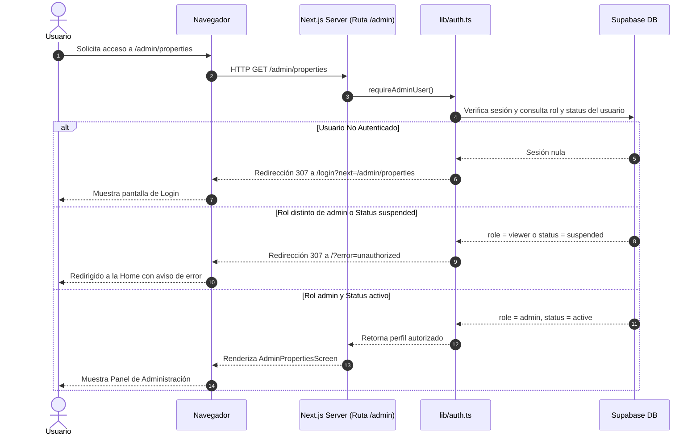

# Casos de Uso y Matriz de Permisos por Rol — LuxeEstate

Este documento especifica de forma gráfica y detallada los **casos de uso**, las capacidades de interacción (**qué pueden hacer**), los alcances de visualización (**qué pueden ver**) y las restricciones de seguridad (**qué NO pueden hacer ni ver**) para cada tipo de usuario en la plataforma inmobiliaria **LuxeEstate**.

---

## 1. Diagrama General de Casos de Uso (UML / Mermaid)

A continuación se muestra el diagrama de casos de uso del sistema, organizando los actores y su interacción con los distintos módulos:



---

## 2. Detalle de Casos de Uso por Tipo de Usuario

---

### 2.1. Visitante Anónimo (Público / No Autenticado)

Representa a cualquier usuario que entra a la web sin haber iniciado sesión.

```mermaid
flowchart TD
    Anon["Visitante Anónimo"]

    Anon --> HacerAnon["QUÉ PUEDE HACER"]
    Anon --> VerAnon["QUÉ PUEDE VER"]
    Anon --> NoAnon["QUÉ NO PUEDE HACER NI VER"]

    subgraph GrupoHacerAnon["Acciones Permitidas"]
        HacerAnon --> A1["Navegar catálogo principal"]
        HacerAnon --> A2["Filtrar por Venta, Alquiler, Categoría y Búsqueda"]
        HacerAnon --> A3["Cambiar idioma ES / EN"]
        HacerAnon --> A4["Hacer clic en Iniciar Sesión"]
        HacerAnon --> A5["Autenticarse con Google o GitHub"]
    end

    subgraph GrupoVerAnon["Vistas Accesibles"]
        VerAnon --> V1["Listados de propiedades con fotos y precios"]
        VerAnon --> V2["Página de detalle de propiedad"]
        VerAnon --> V3["Mapa interactivo, amenities y descripción"]
        VerAnon --> V4["Información pública del agente responsable"]
        VerAnon --> V5["Simulador de hipoteca estimativo"]
    end

    subgraph GrupoNoAnon["Restricciones"]
        NoAnon --> X1["NO puede acceder a rutas /admin"]
        NoAnon --> X2["NO puede ver el botón de Admin Dashboard"]
        NoAnon --> X3["NO puede modificar, crear ni borrar propiedades"]
        NoAnon --> X4["NO puede ver ni gestionar usuarios"]
        NoAnon --> X5["NO tiene menú de perfil activo ni avatar de sesión"]
    end
```



* **Qué PUEDE hacer:**
  * Explorar la página de inicio (`/`) con paginación y listados destacados.
  * Usar la barra de búsqueda y filtros avanzados (categorías: *House, Apartment, Villa, Penthouse*; tipo: *sale, rent*; rango de precio, habitaciones, baños).
  * Consultar fichas completas de propiedades (`/properties/[slug]`).
  * Cambiar el idioma entre Inglés y Español (persistido en cookies de sesión).
  * Navegar a la página de inicio de sesión (`/login`) y autenticarse con OAuth (Google o GitHub).
* **Qué PUEDE ver:**
  * Imágenes en alta resolución, planos/galería y especificaciones físicas (área en m², dormitorios, baños, garajes).
  * Mapa satelital/calle de ubicación aproximada de la propiedad.
  * Tarjeta de presentación del agente responsable (nombre, fotografía, teléfono, correo público).
  * Calculador de hipoteca con cuotas mensuales estimadas.
* **Qué NO PUEDE hacer ni ver:**
  * **NO puede ver** el panel de administración ni ninguna de sus rutas (`/admin`, `/admin/properties`, `/admin/users`). Si intenta ingresar, es redirigido a `/login?next=...`.
  * **NO puede** crear, modificar o eliminar propiedades.
  * **NO puede** ver el directorio interno de empleados/usuarios ni sus métricas de ventas.
  * **NO puede** interactuar con las opciones de perfil de usuario en la barra de navegación.

---

### 2.2. Usuario Autenticado / Viewer (Nivel de Acceso: 1)

Es el usuario que ha iniciado sesión a través de OAuth (Google o GitHub) pero no tiene un rol administrativo o de personal de ventas. Equivale a un cliente comprador o arrendatario.



* **Qué PUEDE hacer:**
  * Todas las acciones permitidas al visitante anónimo.
  * Mantener sesión activa mediante tokens seguros de Supabase Auth.
  * Abrir su menú desplegable de perfil en el encabezado.
  * Cerrar sesión de manera segura (`signOutAction`).
* **Qué PUEDE ver:**
  * Su fotografía de perfil o avatar sincronizado desde su proveedor OAuth.
  * Su nombre completo y dirección de correo asociada en el menú de usuario.
  * Toda la información pública y detallada de los inmuebles.
* **Qué NO PUEDE hacer ni ver:**
  * **NO puede ver** la insignia `"Admin"` ni el botón de acceso al `"Admin Dashboard"` en su menú desplegable.
  * **NO puede acceder** a `/admin/*`. Si fuerza la URL por navegador, el guardián de servidor `requireAdminUser()` detecta `role !== 'admin'` y lo redirige automáticamente a `/?error=unauthorized`.
  * **NO puede** invocar Server Actions de mutación administrativa (`createPropertyAction`, `updatePropertyAction`, `deletePropertyAction`, `updateUserRoleAction`, etc.), las cuales validan el rol en el servidor devolviendo `{ ok: false, error: "unauthorized" }`.

---

### 2.3. Agente Inmobiliario / Agent (Nivel de Acceso: 3)

Corresponde a los agentes comerciales de LuxeEstate responsables de carteras de propiedades y atención al cliente.



* **Qué PUEDE hacer:**
  * Todas las acciones de un usuario autenticado.
  * Figurar como el agente asignado en las propiedades de la cartera de LuxeEstate.
  * Gestionar contactos y solicitudes de tours/visitas recibidas de potenciales clientes.
* **Qué PUEDE ver:**
  * Su ficha pública de asesor con fotografía, teléfono y botón de contacto en la página de detalle de cada propiedad asignada.
  * Sus métricas de rendimiento (propiedades activas y volumen de ventas anual `salesYtd`) calculadas automáticamente por el sistema de datos.
* **Qué NO PUEDE hacer ni ver:**
  * **NO puede** ingresar al panel administrativo `/admin` a menos que sea ascendido a `admin` por un administrador.
  * **NO puede** reasignar roles de seguridad a otros miembros del equipo.

---

### 2.4. Broker Senior / Broker (Nivel de Acceso: 4)

Corresponde al rol de broker o director de ventas inmobiliarias con supervisión sobre portafolios comerciales.



* **Qué PUEDE hacer:**
  * Posee nivel de acceso jerárquico 4 en el catálogo del sistema (`rolesCatalog`).
  * Monitorear y liderar el catálogo de propiedades de lujo y las transacciones de alto volumen.
* **Qué PUEDE ver:**
  * Todo el inventario de propiedades disponibles, destacadas y en venta/renta.
* **Qué NO PUEDE hacer ni ver:**
  * En la configuración actual del sistema, la administración de usuarios y la mutación directa de base de datos en `/admin` está restringida exclusivamente a `role === "admin"`. Los brokers no pueden degradar, crear ni suspender usuarios en el sistema sin intervención de un Administrador.

---

### 2.5. Administrador / Admin (Nivel de Acceso: 5)

Tiene acceso total a la gestión del sistema, tanto en el portal público como en el portal administrativo interno.

```mermaid
flowchart TD
    Admin["Administrador (Nivel 5)"]

    Admin --> HacerAdm["QUÉ PUEDE HACER"]
    Admin --> VerAdm["QUÉ PUEDE VER"]
    Admin --> NoAdm["RESTRICCIONES DE SEGURIDAD"]

    subgraph GrupoHacerAdm["Acciones Permitidas"]
        HacerAdm --> Adm1["Crear propiedades con fotos, amenities y precios"]
        HacerAdm --> Adm2["Editar cualquier propiedad existente"]
        HacerAdm --> Adm3["Eliminar propiedades del catálogo con confirmación"]
        HacerAdm --> Adm4["Crear usuarios y colaboradores desde el panel"]
        HacerAdm --> Adm5["Cambiar rol de usuarios: Admin, Broker, Agent, Viewer"]
        HacerAdm --> Adm6["Cambiar estado: Active, Away, Inactive, Suspended"]
        HacerAdm --> Adm7["Acceder a /admin/properties y /admin/users"]
    end

    subgraph GrupoVerAdm["Vistas Accesibles"]
        VerAdm --> AdmV1["Dashboard /admin con KPIs: Total, Venta, Renta, Destacadas"]
        VerAdm --> AdmV2["Directorio completo de usuarios con filtros por rol"]
        VerAdm --> AdmV3["Métricas de rendimiento de cada agente: ventas YTD"]
        VerAdm --> AdmV4["Datos técnicos: Proveedor OAuth, ID y fechas de acceso"]
        VerAdm --> AdmV5["Enlace directo Admin Dashboard con badge en Navbar"]
    end

    subgraph GrupoNoAdm["Salvaguardas del Sistema"]
        NoAdm --> AdmX1["NO puede auto-degradarse de rol (self_demote_forbidden)"]
        NoAdm --> AdmX2["NO puede auto-suspender su cuenta (self_suspend_forbidden)"]
        NoAdm --> AdmX3["Si su estado pasa a suspended, pierde acceso de inmediato"]
    end
```



* **Qué PUEDE hacer:**
  * **Gestión de Propiedades:**
    * Crear nuevas propiedades (`createPropertyAction`) especificando título, ubicación, precio, si es venta o renta, categoría (*House, Apartment, Villa, Penthouse*), cantidad de habitaciones, baños, metros cuadrados, plazas de garaje, imágenes, amenities y badge destacado.
    * Editar propiedades existentes (`updatePropertyAction`).
    * Eliminar propiedades (`deletePropertyAction`).
  * **Gestión de Usuarios y Roles:**
    * Crear nuevos usuarios (`createUserAction`) con correo, nombre, rol y estado inicial.
    * Cambiar el rol de cualquier usuario (`updateUserRoleAction`).
    * Modificar el estado de cualquier usuario (`updateUserStatusAction` a *Active, Away, Inactive, Suspended*).
    * Filtrar usuarios por rol (*All, Administrators, Senior Brokers, Agents, Viewers*) y realizar búsquedas por nombre o correo.
  * **Control de Navegación:**
    * Visualizar el botón destacado `"Admin Dashboard"` en su menú de usuario.
    * Navegar entre `/admin/properties` y `/admin/users` con barra de navegación administrativa dedicada (`AdminNavbar`).
* **Qué PUEDE ver:**
  * Tarjetas de estadísticas en tiempo real:
    * *Total Listings* (total de propiedades registradas).
    * *Active For Sale* (en venta).
    * *Active For Rent* (en alquiler).
    * *Featured Properties* (propiedades destacadas en portada).
  * Tabla de propiedades con precio formateado, tipo, categoría, badge y menú de acciones por fila.
  * Directorio de usuarios con avatares, identificador corto (`#USR-XXXX`), correo, rol, nivel de acceso, estado y volumen de ventas acumulado YTD.
* **Qué NO PUEDE hacer (Salvaguardas de seguridad integradas):**
  * **Auto-degradación prohibida:** El sistema le impide quitarse a sí mismo el rol de Administrador (`self_demote_forbidden`).
  * **Auto-suspensión prohibida:** El sistema le impide auto-suspenderse (`self_suspend_forbidden`), evitando que el sistema quede sin administradores activos.

---

### 2.6. Caso Especial: Usuario con Estado Suspendido (`suspended`)

Cualquier usuario cuyo estado sea marcado como `suspended` por un Administrador:



* **Comportamiento:**
  * Aunque su `role` sea `admin`, la verificación estricta en `lib/auth.ts`:
    ```typescript
    if (user.role !== "admin" || user.status === "suspended") {
      redirect("/?error=unauthorized");
    }
    ```
    bloquea su entrada al panel administrativo.
  * Todas las Server Actions de mutación rechazan sus solicitudes de inmediato.

---

## 3. Matriz Comparativa de Permisos (CRUD y Visualización)

| Módulo / Funcionalidad | Visitante Anónimo | Viewer (Cliente) | Agent (Agente) | Broker Senior | Admin (Administrador) |
| :--- | :---: | :---: | :---: | :---: | :---: |
| **Nivel de Acceso Numérico** | 0 | 1 | 3 | 4 | **5** |
| **Explorar catálogo de propiedades** | ✅ Ver | ✅ Ver | ✅ Ver | ✅ Ver | ✅ Ver |
| **Búsqueda y filtros avanzados** | ✅ Usar | ✅ Usar | ✅ Usar | ✅ Usar | ✅ Usar |
| **Ver detalle de propiedad (fotos, mapa, info)** | ✅ Ver | ✅ Ver | ✅ Ver | ✅ Ver | ✅ Ver |
| **Cambio de idioma (EN/ES)** | ✅ Usar | ✅ Usar | ✅ Usar | ✅ Usar | ✅ Usar |
| **Simulador de hipoteca** | ✅ Ver | ✅ Ver | ✅ Ver | ✅ Ver | ✅ Ver |
| **Iniciar sesión vía OAuth (Google/GitHub)** | ✅ Hacer | ➖ *(Ya autenticado)* | ➖ *(Ya autenticado)* | ➖ *(Ya autenticado)* | ➖ *(Ya autenticado)* |
| **Menú de perfil y botón de Sign Out** | ❌ No | ✅ Ver/Hacer | ✅ Ver/Hacer | ✅ Ver/Hacer | ✅ Ver/Hacer |
| **Contactar agente de propiedad** | ✅ Hacer | ✅ Hacer | ✅ Hacer | ✅ Hacer | ✅ Hacer |
| **Aparecer como agente asignado** | ❌ No | ❌ No | ✅ Sí | ✅ Sí | ❌ No *(Salvo asignación explícita)* |
| **Acceso a `/admin/properties`** | ❌ Bloqueado | ❌ Bloqueado | ❌ Bloqueado | ❌ Bloqueado | ✅ **Acceso Total** |
| **Crear nueva propiedad** | ❌ No | ❌ No | ❌ No | ❌ No | ✅ **Hacer** |
| **Editar propiedades existentes** | ❌ No | ❌ No | ❌ No | ❌ No | ✅ **Hacer** |
| **Eliminar propiedades** | ❌ No | ❌ No | ❌ No | ❌ No | ✅ **Hacer** |
| **Ver KPIs y métricas de listados** | ❌ No | ❌ No | ❌ No | ❌ No | ✅ **Ver** |
| **Acceso a `/admin/users`** | ❌ Bloqueado | ❌ Bloqueado | ❌ Bloqueado | ❌ Bloqueado | ✅ **Acceso Total** |
| **Ver directorio de usuarios y correos** | ❌ No | ❌ No | ❌ No | ❌ No | ✅ **Ver** |
| **Ver ventas y métricas por agente** | ❌ No | ❌ No | ❌ No | ❌ No | ✅ **Ver** |
| **Modificar rol de un usuario** | ❌ No | ❌ No | ❌ No | ❌ No | ✅ **Hacer** *(Excepto a sí mismo)* |
| **Modificar estado de un usuario** | ❌ No | ❌ No | ❌ No | ❌ No | ✅ **Hacer** *(Excepto auto-suspensión)* |
| **Crear nuevo usuario desde admin** | ❌ No | ❌ No | ❌ No | ❌ No | ✅ **Hacer** |

---

## 4. Diagrama de Secuencia: Control de Acceso y Autorización

El siguiente diagrama ejemplifica cómo el sistema procesa una solicitud hacia un recurso protegido (`/admin`) según el rol del usuario:



---

*Documento generado y alineado con la arquitectura de código y seguridad de LuxeEstate.*
